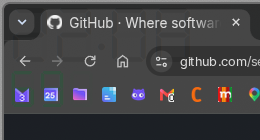

# Zegary

Zegar cyfrowy (LCD) ze wskaźnikiem baterii na pulpit **Omarchy** (Hyprland + Quickshell).
Wyświetla się w **lewym górnym rogu** pulpitu — nad tapetą, pod oknami — i nie przechwytuje kliknięć.



## Funkcje

- Zegar `HH:MM` w czcionce siedmiosegmentowej (LCD) **DSEG7 Classic**
- Pod zegarem poziom baterii (bez znaku `%`), kolor zależny od naładowania:
  - 🟢 zielony — 50–100%
  - 🟡 żółty — 21–49%
  - 🔴 czerwony — 20–1%
- Za cyframi widoczny przygaszony „ghost” `88:88` / `888` (efekt niepodświetlonych segmentów)
- Kolor zegara = akcent aktualnego motywu

## Instalacja — jedna komenda

```bash
curl -fsSL https://raw.githubusercontent.com/marmuto/zegary/main/install.sh | bash
```

Instalator:
1. zapisuje wtyczkę do `~/.config/omarchy/plugins/mrcn.desktop-clock/`,
2. instaluje czcionkę DSEG7 do `~/.local/share/fonts/DSEG/`,
3. dopisuje `mrcn.desktop-clock` do `~/.config/omarchy/shell.json` (z kopią zapasową),
4. restartuje shella (`omarchy restart shell`).

## Wymagania

- **Omarchy** (Hyprland + Quickshell)
- `curl`, `python3`, `fc-cache` (są domyślnie w Omarchy)

## Dostosowanie

Edytuj `~/.config/omarchy/plugins/mrcn.desktop-clock/Panel.qml`:

| Opcja | Znaczenie | Domyślnie |
|---|---|---|
| `clockFontSize` | rozmiar cyfr zegara | `54` |
| `batteryFontSize` | rozmiar cyfr baterii | `36` |
| `batteryGreen` | kolor 50–100% | `#00ff66` |
| `batteryYellow` | kolor 21–49% | `#ffd400` |
| `batteryRed` | kolor ≤ 20% | `#ff3b30` |
| `lcdColor` | kolor zegara | `Color.accent` (akcent motywu) |

Zmiany wczytują się po zapisie. Po większych zmianach wykonaj:

```bash
omarchy restart shell
```

## Czcionki

DSEG © keshikan (http://www.keshikan.net), licencja **SIL OFL 1.1** — patrz `fonts/DSEG-LICENSE.txt`.

## Licencja

Kod: **MIT**. Czcionki: **SIL OFL 1.1**.
